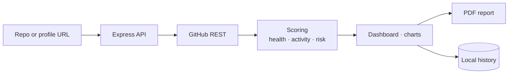

<div align="center">



<p>
  <a href="https://repository-insights-kappa.vercel.app"></a>
  
  
  
</p>

<p><em>A complete picture of any public GitHub repository or developer, in seconds.<br>
Paste a URL, get deep insights. No sign-up, no API keys.</em></p>

</div>


## Features

| | |
|---|---|
| **Repo analyser** | A health score, commit trends, language breakdown and risk assessment. |
| **Developer insights** | A developer score, language expertise, portfolio stats and a shareable card. |
| **Compare** | Two repositories side by side across ten-plus metrics. |
| **History** | Recent analyses saved locally, one click to revisit. |
| **PDF export** | The full report as a PDF. |
| **Languages and themes** | English and Turkish, dark and light. |




## Türkçe özet

**GitVitals**, herhangi bir herkese açık GitHub deposunun ya da geliştirici profilinin tam resmini saniyeler içinde çıkaran bir analiz aracı. Adresi yapıştırınca sağlık puanı, commit eğilimleri, dil dağılımı ve risk değerlendirmesi geliyor; iki depoyu yan yana karşılaştırıp raporu PDF olarak indirebiliyorsun. Kayıt ya da API anahtarı gerekmiyor.


## Development

```sh
npm install
npm run dev      # Express + Vite
npm run build
npm start
```

```
client/   React app
server/   Express API and GitHub client
shared/   shared types and schema
```

<div align="center">
<br>
<a href="https://github.com/kutluhangil"></a>
<sub>Take your repository's pulse.</sub>
</div>
