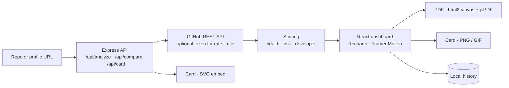

<div align="center">


<p>
  <a href="https://repository-insights-kappa.vercel.app"></a>
  
  
  
</p>

<p><em>The health check for GitHub. Paste any public repository or profile and get a health score,<br>
a risk assessment, activity trends and a developer card, in seconds and without signing up.</em></p>

</div>


## The idea

Before you depend on a library, hire a developer or pick an open-source project to contribute to, you want to know whether it is alive. Stars alone do not tell you. GitVitals reads the repository through the GitHub API and turns it into three plain answers: how healthy it looks, how risky it is to rely on, and what the person behind it has built.

> **Every score is a short, readable rule.** The health score starts at 50 and earns points for a licence, a description, topics, issues and wiki enabled, more than 50 commits, more than 5 contributors and more than 100 stars. The risk score adds points for a year without commits, a single contributor, a flood of open issues, no licence and a thin history, and lists each warning it found.


## Features

| | |
|---|---|
| **Repo analysis** | Health meter, stars, forks, commits, contributors, commit trend, language breakdown and topics. |
| **Risk assessment** | Low, medium or high risk with the exact warnings behind it, such as "single contributor: extreme bus factor risk". |
| **Developer insights** | Paste a profile for a developer score (repos, stars, followers, account age, original work, impact) and a level from *Inactive* to *Elite Developer*. |
| **Developer card** | A shareable card you can save as PNG or as an animated GIF, rendered in the browser. |
| **Embeddable card** | `/api/card?user=<name>` returns the card as SVG, in portrait or banner orientation, ready for a profile README. |
| **Compare** | Two repositories side by side across the same metrics. |
| **PDF report** | The full dashboard exported to an A4 PDF. |
| **History** | Recent analyses kept in local storage, one click to reopen. |
| **TR / EN, dark and light** | Two languages and two themes. |


## How the scores add up

| Health (starts at 50, max 100) | Points |
|---|---|
| Has a licence | +10 |
| More than 50 commits · more than 5 contributors · more than 100 stars | +10 each |
| Has a description · topics · issues enabled · wiki | +5 each |

| Risk (0–100) | Points |
|---|---|
| Last commit over a year ago · over 6 months · over 90 days | +35 · +20 · +10 |
| Single contributor · fewer than three | +25 · +12 |
| Over 1,000 open issues · over 200 | +20 · +10 |
| No licence · fewer than 10 commits | +10 each |

| Developer (0–100) | Up to |
|---|---|
| Total stars | 25 |
| Public repos · followers | 15 each |
| A repo with real traction (forks or stars) | 15 |
| Account age · original (non-fork) repos | 10 each |


## How it fits together



| Endpoint | Does |
|---|---|
| `GET /api/analyze?url=` | Analyse a repository or a profile |
| `GET /api/compare?urlA=&urlB=` | Two repositories side by side |
| `GET /api/card?user=&style=&orientation=` | The developer card as SVG |


## Türkçe özet

**GitVitals**, herkese açık bir GitHub deposunun ya da geliştirici profilinin sağlık kontrolünü yapan bir araç. Adresi yapıştırınca sağlık puanı, risk değerlendirmesi ve uyarıları, commit eğilimi, dil dağılımı geliyor; profil için geliştirici puanı ve PNG, GIF ya da README'ye gömülebilir SVG olarak paylaşılabilen bir geliştirici kartı çıkıyor. İki depo yan yana karşılaştırılabiliyor, rapor PDF olarak indirilebiliyor. Kayıt gerekmiyor; puanların her biri kısa ve okunabilir kurallarla hesaplanıyor.


## Development

```sh
npm install
npm run dev      # Express + Vite
npm run check    # tsc
npm run build
npm start
```

`GITHUB_TOKEN` is optional and only raises the GitHub rate limit. On Vercel, `api/index.ts` serves the API and every other path falls back to the client.

```
client/src/components/   Dashboard, RepoDashboard, ProfileDashboard, CompareView, DeveloperCard, HealthMeter
client/src/hooks/        use-analyze, use-history
api/index.ts             the API and scoring (Vercel function)
server/                  the same routes for local and self-hosted runs
shared/                  shared schema
```

<div align="center">
<br>
<a href="https://github.com/kutluhangil"></a>
<sub>All rights reserved · data from the GitHub REST API · the repo and numbers in the banner are invented.</sub>
</div>
